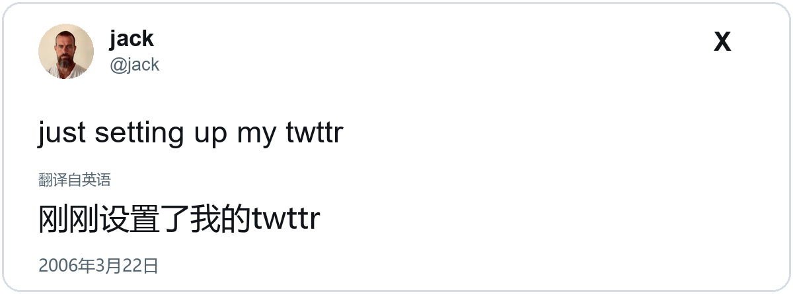

# x-post2image · Agent Skill

把任意公开的 X / Twitter 推文变成一张干净、高清、可直接发布的「推文卡片」PNG。

这个目录是 [Yunshiro/x-post2image](https://github.com/Yunshiro/x-post2image) 的 Agent Skill 封装版：原项目是一个 Chrome 扩展，需要在浏览器里点分享菜单；这个版本把同样的视觉能力改写成任何 Agent 都能直接调用的命令行工具——无需扩展、无需登录 X、无需打开浏览器窗口。同时集成了 [ljunnan24-hash/x-insight-cards](https://github.com/ljunnan24-hash/x-insight-cards) 的选题、评分、去重、配文、每日任务和微信私有交付生产线。


## 特性

- **任意 Agent 可用**：一个 `SKILL.md` + 一个零 npm 依赖的 Node CLI，Claude Code / Codex / Gemini CLI / Cursor / DSH 都能加载。
- **不用登录**：公开推文通过 X syndication 与 fxTwitter 公共接口读取。
- **X 原生观感**：Chirp 字体（不可用时自动回退系统字体）、X 的深色 / dim / 浅色配色、认证徽章、媒体九宫格、引用推文、投票条。
- **可编辑互动数据**：评论 / 转发 / 点赞 / 曝光数量可覆盖，用于设计稿或演示（不能当作真实数据）。
- **中文翻译**：`--translate zh-CN` 自动翻译正文、引用推文和投票选项，并在卡片上显示「翻译自英语」；`--bilingual` 可同时保留原文。
- **长推文 X 风格长卡**：超过阈值（默认 360 字符）自动切换为 X 官方风格长卡，真实头像、X 标、代码块、日期/时区，内容自动撑高不溢出；`--layout spread` 可选两页版。
- **完整内容生产线**：`scripts/insight.mjs` 提供选题 URL → 核验 → 100 分评分 → URL/正文哈希去重 → 自适应双语排版 → 中文配文 → QA → 历史记录 → 微信 iLink 私有交付。
- **媒体本地化 / 离线重渲**：头像和配图下载为 data URL 并缓存，第一次成功后可 `--offline` 重渲。
- **高清输出**：默认 600 CSS px 宽 × 2 倍像素密度 = 1200 px 宽 PNG。
- **多种主题**：`dark` / `dim` / `light`，支持圆角卡片和透明背景。
- **HTML 也可用**：`--html-only` 输出可嵌入网页的 HTML 卡片。

| 浅色 | dim |
|---|---|
|  |  |

复杂内容（多图九宫格 + 引用推文 + 投票 + 中文数字）也能一次渲染：


视频 / GIF 使用封面帧并叠加播放按钮：


翻译成中文（可加 `--bilingual` 同时显示原文）：


Insight 排版示例（自适应双语 + Pillow 确定性渲染）：



长推文自动切换 X 官方风格长卡（真实头像、X 标、代码块、内容不溢出）：


## 安装

把整个 `x-post2image/` 文件夹复制到你的 Agent 技能目录：

| Agent | 目录 |
|---|---|
| Claude Code | `~/.claude/skills/x-post2image/` |
| Codex / Gemini CLI / DSH / 通用 Agent Skills | `~/.agents/skills/x-post2image/` |
| 项目内 | `<project>/.claude/skills/` 或 `<project>/.agents/skills/` |

也可以一条命令安装到默认的 `~/.agents/skills`：

```bash
node scripts/install-skill.mjs
# 或指定目录 / 覆盖旧版本
node scripts/install-skill.mjs --target ~/.claude/skills --force
```

无需构建、无需 `npm install`。运行时只需要：

- Node.js >= 18
- 本机有 Chrome / Chromium / Edge（脚本会自动查找）

可选：如果希望用 Playwright 渲染，`npm install playwright && npx playwright install chromium`，然后加 `--engine playwright`。

Insight 内容生产线额外需要 Python 3.10+ 和 Pillow：

```bash
python -m pip install -r requirements.txt
```

## 快速使用

```bash
cd x-post2image

# 最简：深色卡片
node scripts/x-post2image.mjs "https://x.com/jack/status/20" --out jack.png

# 浅色、中文数字格式
node scripts/x-post2image.mjs "https://x.com/jack/status/20" --out jack-light.png --theme light --lang zh-CN

# 翻译成中文
node scripts/x-post2image.mjs "https://x.com/TheEllenShow/status/440322224407314432" --out ellen-zh.png --translate zh-CN

# 翻译 + 原文对照
node scripts/x-post2image.mjs "https://x.com/jack/status/20" --out jack-zh.png --translate zh-CN --bilingual

# 强制长推文 X 风格长卡（默认超过 360 字符也会自动触发）
node scripts/x-post2image.mjs "https://x.com/jack/status/20" --out long.png --layout tall

# 改互动数据（仅用于设计稿）
node scripts/x-post2image.mjs "https://x.com/jack/status/20" --out mock.png --likes 12K --views 2.4M

# 批量
node scripts/x-post2image.mjs <url1> <url2> --out-dir out/

# 环境自检
node scripts/x-post2image.mjs --doctor
```

`--json` 会输出机器可读结果：

```json
{
  "ok": true,
  "id": "20",
  "out": "D:\\...\\jack.png",
  "width": 1200,
  "height": 326,
  "theme": "dark",
  "source": "syndication+fxtwitter"
}
```

完整参数见 [`SKILL.md`](SKILL.md) 或 `node scripts/x-post2image.mjs --help`。

## 长推文：X 风格长卡（可选两页）

当推文文本达到 **360 字符**（可用 `--long-threshold` 调整）时，`--layout auto` 会自动从普通 X 单页卡片切换成 **X 官方风格长卡**，参考你给的示例：

- 1080px 宽、白色圆角卡片、X 灰色背景；
- 真实头像、姓名、@handle、认证徽章、右上角 X 标；
- 大号正文自动向下排版，卡片高度随内容增长，**不溢出、不截断**；
- 支持代码块；
- 底部显示日期、时区 pill 与 `AI 翻译`，没有多余的表格或空白。

```bash
# 自动：超过 360 字符走 X 风格长卡
node scripts/x-post2image.mjs "<url>" --translate zh-CN --out long.png

# 强制长卡 / 强制单页
node scripts/x-post2image.mjs "<url>" --layout tall --out long.png
node scripts/x-post2image.mjs "<url>" --layout single --out single.png

# 可选：两页 article spread（上一版布局）
node scripts/x-post2image.mjs "<url>" --layout spread --out spread.png
```

长卡由 Pillow 确定性渲染，需要 Python 3.10+ 和 Pillow（见 `requirements.txt`）。

## Insight 内容生产线

如果目标不是「给一条推文做图」，而是「每天找 3–5 条值得发的 X 内容，做成抖音/小红书素材」，用 `scripts/insight.mjs`：

```bash
# 单条推文 → 一张自适应 insight 卡（不需要评分）
node scripts/insight.mjs single "https://x.com/jack/status/20" --out insight.png --translate zh-CN

# 1. 生成 X 搜索链接（用浏览器/搜索工具打开，收集 status URL 到 urls.json）
node scripts/insight.mjs search --topic "habits" --hours 24 --min-faves 100

# 2. 核验候选并翻译
node scripts/insight.mjs verify --input urls.json --output candidates.json --translate zh-CN

# 3. 在 candidates.json 里填 score_detail 和 caption 后，评分/去重/选最多 5 条
node scripts/insight.mjs rank --input candidates.json --history history.jsonl --output ranked.json

# 4. 用 Pillow 自适应双语渲染、QA、打包
node scripts/insight.mjs render --input ranked.json --out-dir out
node scripts/insight.mjs qa --input ranked.json --out-dir out --output out/qa.json
node scripts/insight.mjs pack --input ranked.json --out-dir out --output out/pack.json

# 5. 完整每日任务（含 catch-up、锁、run_completion、history）
node scripts/insight.mjs daily --input candidates.json --history history.jsonl --out-dir out \
  --scheduled-for 2026-11-05T12:00:00+08:00
```

这条流水线包含：

- 100 分评分：认知增量 30 / 表达清晰 20 / 中文适配 20 / 来源可信 15 / 新鲜度 10 / 可读性 5；低于 75 直接淘汰，不凑数。
- 按 canonical URL + 正文 SHA-256 去重，写入 `history.jsonl`。
- 自适应双语：估算双语总高度 ≤ 1200px 时显示英文原文 + 中文；超过时自动切换为「仅中文 + 译自英文原帖」。
- CJK 排版：标点避头尾、避免行首闭合标点、避免孤字、保留段落空行。
- 真实作者头像硬校验；没有真实头像直接失败，不用首字母/生成头像。
- 中文配文 1–2 句 + 3–5 个 hashtag；QA 自动校验。
- 可选微信 iLink 私有审核交付（固定收件人、后台 listener、检查点、断点续传；不是自动发布到抖音/小红书）。

详细规则见 [`references/insight-discovery.md`](references/insight-discovery.md)、[`insight-scoring.md`](references/insight-scoring.md)、[`insight-typography.md`](references/insight-typography.md)、[`insight-caption.md`](references/insight-caption.md)、[`insight-qa.md`](references/insight-qa.md)、[`insight-candidate-schema.md`](references/insight-candidate-schema.md)、[`insight-scheduling.md`](references/insight-scheduling.md)、[`private-delivery.md`](references/private-delivery.md)。

## 一定要联网吗？

**第一次渲染一条新推文：需要外网。** 因为要：

1. 从 X syndication / fxTwitter 读取推文 JSON；
2. 从 `pbs.twimg.com` 下载头像和配图；
3. 可选地从 MyMemory / Google 调用翻译；
4. 可选地从 `abs.twimg.com` 加载 Chirp 字体（加载不到就用系统字体）。

**成功渲染过一次之后：可以离线重渲。** 推文 JSON、头像/配图（以 data URL 形式）、翻译结果都会缓存到 `~/.cache/x-post2image/`，之后加 `--offline` 即可复用：

```bash
# 第一次：联网
node scripts/x-post2image.mjs <url> --translate zh-CN --out card.png

# 之后：断网也能重渲同样的内容
node scripts/x-post2image.mjs <url> --translate zh-CN --out card-2.png --offline
```

如果所在网络访问不了 `pbs.twimg.com`（例如中国大陆网络），脚本会自动改走 `wsrv.nl` 图片代理下载配图；如果代理也不可用，卡片仍会生成，但对应图片会被省略。

## 工作原理

1. **取数**：并行请求 X 的公开 syndication 接口和 `api.fxtwitter.com`，合并作者、文本、媒体、引用、投票与互动数据；两者都失败时读取本地缓存。
2. **媒体本地化**：头像和配图先下载为 data URL（直连失败时走 `wsrv.nl` 图片代理），保证截图不依赖浏览器能否访问 X 的 CDN；同时写入缓存，供 `--offline` 使用。
3. **翻译**：`scripts/lib/translate.mjs` 调用 MyMemory（失败时尝试 Google），翻译正文、引用推文和投票选项；URL / @提及 / #话题会先做占位保护，翻译后原样还原。
4. **渲染**：`scripts/lib/render.mjs` 生成本地 HTML 卡片，使用 X 的配色、Chirp 字体、内联 SVG 图标。
5. **截图**：优先 Playwright；没有 Playwright 时用本机 Chrome headless 的「先测量、再截图」两段式流程。默认零 npm 依赖。

原版扩展的工作方式是在 x.com 页面里克隆真实推文 DOM，再用 `html-to-image` 转 PNG。这个 skill 保留了同样的视觉目标，但把实现搬到可移植的 CLI。对照说明见 [`references/upstream-notes.md`](references/upstream-notes.md)。

## 限制

- 只支持公开推文；受保护、已删除、年龄限制的推文会报错。
- 视频 / GIF 只渲染封面帧 + 播放标记，不包含音频或动画。
- 翻译由免费的 MyMemory / Google 公共接口提供，属于机器翻译，专有名词和语气可能需要人工校对；免费额度有限，批量翻译大量推文可能触发限流。卡片会标注「翻译自…」。
- Insight 生产线的发现步骤需要 Agent 用浏览器/搜索工具打开 X 搜索；X 没有稳定公开的关键词搜索 API，这不是脚本能凭空绕过的。
- 微信 iLink 交付需要 WeClaw 账号/凭据，且默认只私发到固定审核人，不做平台自动发布。
- 这是「X 风格重绘」，不是 x.com 的实时像素级截屏；X 改版后视觉细节可能需要更新。
- 编辑过的互动数据不能作为真实数据传播。图片版权归原作者，请保留作者署名。

## 目录结构

```
x-post2image/
├── SKILL.md                 # Agent 读取的技能说明
├── README.md                # 本文件
├── LICENSE                  # MIT
├── NOTICE.md                # 上游归属与衍生说明
├── agents/openai.yaml       # Agent 界面元数据
├── requirements.txt         # Insight 渲染器 Pillow 依赖
├── scripts/
│   ├── x-post2image.mjs     # 单条推文原生卡片 CLI
│   ├── long.mjs             # 长推文 X 风格长卡 / 可选两页
│   ├── insight.mjs          # Insight 内容生产线总入口
│   ├── lib/                 # 取数、媒体缓存、翻译、渲染、截图、格式化
│   └── insight/             # 核验、评分、Pillow 渲染、QA、打包、每日任务
├── references/              # 维护者与流水线规则文档
├── test/                    # 单元测试 + 端到端测试
├── examples/                # 示例成品
└── dist/                    # 可分发 zip
```

## 许可

MIT。上游项目 © 2026 x-post2image contributors，见 [`LICENSE`](LICENSE)、[`THIRD_PARTY_NOTICES.md`](THIRD_PARTY_NOTICES.md) 与 [`NOTICE.md`](NOTICE.md)。本项目与 X Corp. 无关。
